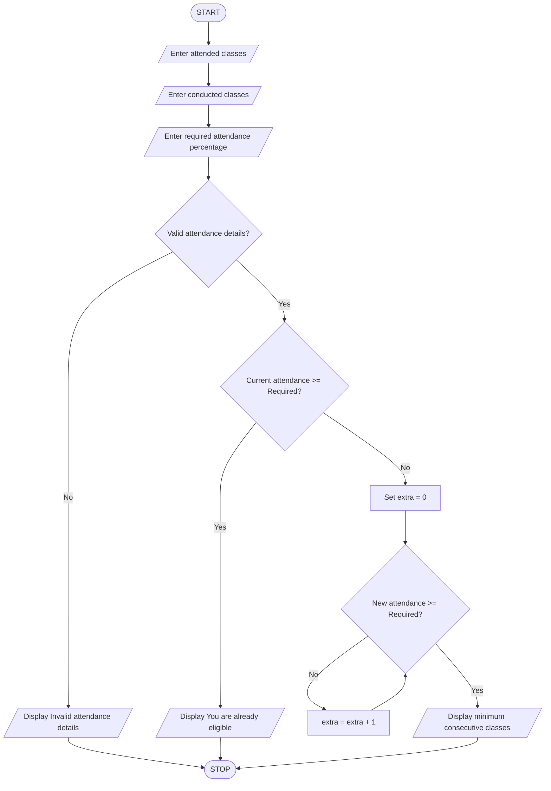

# Student Attendance Eligibility Calculator Using Python

## 1. Problem Statement

Write a Python program to check whether a student is eligible based on their attendance percentage.

The program should:

- Accept the number of classes attended.
- Accept the total number of classes conducted.
- Accept the required attendance percentage.
- Validate the attendance details.
- Calculate the current attendance percentage.
- If the student already meets the required attendance, display "You are already eligible".
- Otherwise, calculate the minimum number of consecutive classes the student must attend to reach the required attendance percentage.
- Display the minimum number of classes to attend.

## 2. Algorithm

1. Start the program.
2. Enter the number of classes attended.
3. Enter the total number of classes conducted.
4. Enter the required attendance percentage.
5. Check whether the attendance details are valid.
6. If total classes are zero, attended classes are negative, or attended classes exceed conducted classes, display "Invalid attendance details".
7. Otherwise, calculate the attendance percentage.
8. Check whether the attendance percentage is greater than or equal to the required percentage.
9. If yes, display "You are already eligible".
10. Otherwise:
    - Initialize extra classes to zero.
    - Use a while loop to calculate attendance after attending additional consecutive classes.
    - Increase extra classes by one until the required percentage is reached.
11. Display the minimum consecutive classes to attend.
12. Stop the program.

## 3. Pseudocode

START

INPUT attended
INPUT conducted
INPUT required

IF conducted <= 0 OR attended < 0
   OR attended > conducted THEN

    DISPLAY "Invalid attendance details"

ELSE IF (attended * 100 / conducted) >= required THEN

    DISPLAY "You are already eligible"

ELSE

    extra = 0

    WHILE ((attended + extra) * 100 /
          (conducted + extra)) < required DO

        extra = extra + 1

    END WHILE

    DISPLAY "Minimum consecutive classes to attend:", extra

END IF

STOP
### 4. Flowchart 

## 5. Sample Input
Enter classes attended: 60
Enter total classes conducted: 100
Enter required attendance percentage: 75
## 6. Sample Output
Minimum consecutive classes to attend: 60

