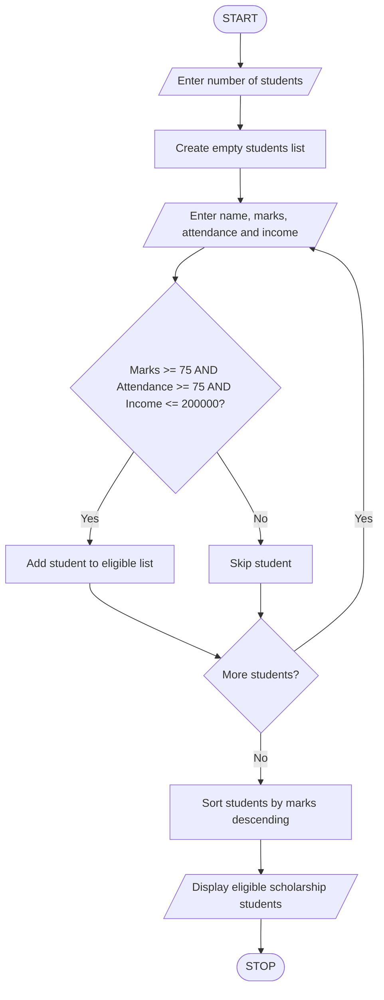

# University Scholarship Allocation Using Python

### 1. Problem Statement

Write a Python program to identify students eligible for a university scholarship based on their aggregate percentage, attendance percentage, and family annual income.

A student is eligible for the scholarship if:

- Aggregate percentage is greater than or equal to 75%.
- Attendance percentage is greater than or equal to 75%.
- Family annual income is less than or equal to Rs. 2,00,000.

Store the eligible students' names and marks in a list. Sort the eligible students in descending order of aggregate percentage and display their details.

### 2. Algorithm

1. Start the program.
2. Read the number of students.
3. Create an empty list to store eligible students.
4. Repeat the following steps for each student:
   - Enter the student's name.
   - Enter aggregate percentage.
   - Enter attendance percentage.
   - Enter family annual income.
5. Check whether marks are at least 75%, attendance is at least 75%, and income is at most Rs. 2,00,000.
6. If all conditions are satisfied, add the student's name and marks to the eligible students list.
7. Otherwise, skip that student.
8. Sort the eligible students in descending order of marks.
9. Display the eligible scholarship students with their marks.
10. Stop the program.

### 3. Pseudocode

START

INPUT n

CREATE empty students list

FOR i = 1 TO n

    INPUT name
    INPUT marks
    INPUT attendance
    INPUT income

    IF marks >= 75 AND attendance >= 75
       AND income <= 200000 THEN

        ADD (name, marks) TO students

    END IF

END FOR

SORT students in descending order of marks

DISPLAY "Eligible Scholarship Students"

FOR each student IN students

    DISPLAY student name, marks

END FOR

STOP

### 4. Flowchart 

### 5. Sample Input

Enter number of students: 4

Enter student name: Ravi
Enter aggregate percentage: 85
Enter attendance percentage: 90
Enter family annual income: 150000

Enter student name: Sita
Enter aggregate percentage: 92
Enter attendance percentage: 95
Enter family annual income: 180000

Enter student name: Kumar
Enter aggregate percentage: 70
Enter attendance percentage: 85
Enter family annual income: 100000

Enter student name: Priya
Enter aggregate percentage: 88
Enter attendance percentage: 80
Enter family annual income: 250000
### 6. Sample Output
Eligible Scholarship Students:

Sita 92.0
Ravi 85.0

