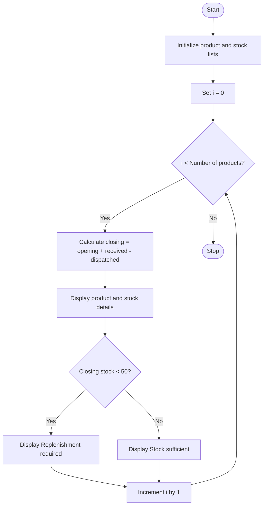

## 1. Problem Statement

To develop a Python program to manage inventory stock for different products. The program calculates the closing stock using opening stock, received stock, and dispatched stock. If the closing stock is less than 50, it displays "Replenishment required"; otherwise, it displays "Stock sufficient".

## 2. Algorithm

1. Start.
2. Initialize product names, opening stock, received stock, and dispatched stock.
3. Repeat for each product using a `for` loop.
4. Calculate closing stock:

   Closing Stock = Opening Stock + Received − Dispatched
5. Display product details and closing stock.
6. If closing stock is less than 50, display "Replenishment required".
7. Otherwise, display "Stock sufficient".
8. Stop.

## 3. Pseudocode
START

Initialize products = ["Books", "Pens", "Notebooks"]
Initialize opening = [100, 200, 150]
Initialize received = [50, 100, 50]
Initialize dispatched = [80, 120, 100]

FOR each product index i:
    closing = opening[i] + received[i] - dispatched[i]

    DISPLAY products[i]
    DISPLAY opening[i]
    DISPLAY received[i]
    DISPLAY dispatched[i]
    DISPLAY closing

    IF closing < 50 THEN
        DISPLAY "Replenishment required"
    ELSE
        DISPLAY "Stock sufficient"
    END IF
END FOR

STOP
## 4. Flowchart

## 5. Sample Input

The program uses predefined stock details, so no user input is required.

| Product   | Opening | Received | Dispatched |
| --------- | ------- | -------- | ---------- |
| Books     | 100     | 50       | 80         |
| Pens      | 200     | 100      | 120        |
| Notebooks | 150     | 50       | 100        |

## 6. Sample Output
Product: Books
Opening stock: 100
Received: 50
Dispatched: 80
Closing stock: 70
Stock sufficient

Product: Pens
Opening stock: 200
Received: 100
Dispatched: 120
Closing stock: 180
Stock sufficient

Product: Notebooks
Opening stock: 150
Received: 50
Dispatched: 100
Closing stock: 100
Stock sufficient

