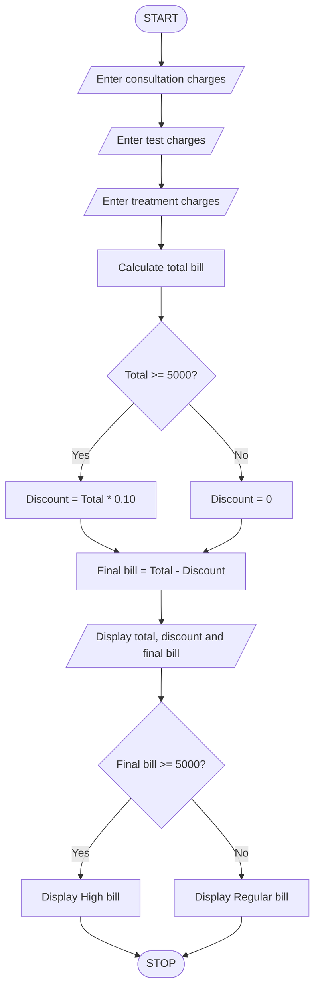

# Hospital Billing and Discount Calculator Using Python

## 1. Problem Statement

Write a Python program to calculate a patient's hospital bill based on consultation charges, test charges, and treatment charges.

The program should:

- Accept consultation charges.
- Accept medical test charges.
- Accept treatment charges.
- Calculate the total bill.
- Provide a 10% discount if the total bill is Rs. 5,000 or above.
- Calculate the final bill after discount.
- Classify the bill as a High Bill or Regular Bill based on the final amount.

## 2. Algorithm

1. Start the program.
2. Enter consultation charges.
3. Enter test charges.
4. Enter treatment charges.
5. Calculate the total bill by adding all charges.
6. Check whether the total bill is greater than or equal to Rs. 5,000.
7. If yes, calculate a 10% discount.
8. Otherwise, set the discount to zero.
9. Calculate the final bill by subtracting the discount from the total bill.
10. Display the total bill, discount, and final bill.
11. Check whether the final bill is greater than or equal to Rs. 5,000.
12. If yes, display "High bill".
13. Otherwise, display "Regular bill".
14. Stop the program.

## 3. Pseudocode
START

INPUT consultation
INPUT tests
INPUT treatment

total = consultation + tests + treatment

IF total >= 5000 THEN
    discount = total * 0.10
ELSE
    discount = 0
END IF

final_bill = total - discount

DISPLAY total
DISPLAY discount
DISPLAY final_bill

IF final_bill >= 5000 THEN
    DISPLAY "High bill"
ELSE
    DISPLAY "Regular bill"
END IF

STOP

## 4. Flowchart 

## 5. Sample Input
Enter consultation charge: 2000
Enter test charges: 2500
Enter treatment charges: 2000

## 6. Sample Output
Total bill: Rs. 6500.0

Discount: Rs. 650.0

Final bill: Rs. 5850.0

Classification: High bill
