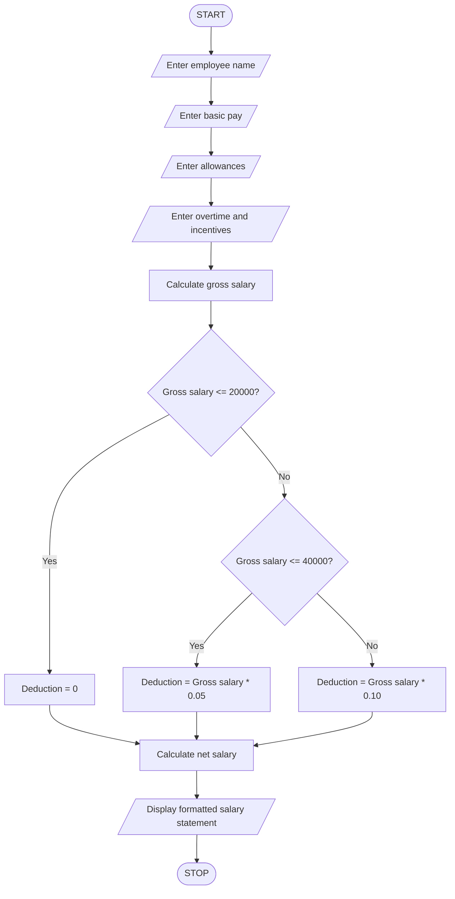

# Employee Payroll and Deduction Analysis Using Python

## 1. Problem Statement

Write a Python program to calculate an employee's gross salary based on basic pay, allowances, overtime, and incentives.

The program should:

- Accept employee name and basic salary.
- Accept allowances, overtime pay, and incentives.
- Calculate gross salary by adding all earnings.
- Apply progressive deductions based on gross salary.
- Calculate the net salary after deductions.
- Generate and display a formatted salary statement.

Assumed deduction rules for this program:

- Gross salary up to Rs. 20,000: No deduction.
- Gross salary above Rs. 20,000 and up to Rs. 40,000: 5% deduction.
- Gross salary above Rs. 40,000: 10% deduction.

## 2. Algorithm

1. Start the program.
2. Enter employee name.
3. Enter basic salary.
4. Enter allowances.
5. Enter overtime pay.
6. Enter incentives.
7. Calculate gross salary by adding basic salary, allowances, overtime, and incentives.
8. Check the gross salary:
   - If gross salary is less than or equal to Rs. 20,000, deduction is zero.
   - If gross salary is less than or equal to Rs. 40,000, apply 5% deduction.
   - Otherwise, apply 10% deduction.
9. Calculate net salary by subtracting deductions from gross salary.
10. Display the employee salary statement.
11. Stop the program.

## 3. Pseudocode
START

INPUT employee_name
INPUT basic_pay
INPUT allowances
INPUT overtime
INPUT incentives

gross_salary = basic_pay + allowances
               + overtime + incentives

IF gross_salary <= 20000 THEN
    deduction = 0

ELSE IF gross_salary <= 40000 THEN
    deduction = gross_salary * 0.05

ELSE
    deduction = gross_salary * 0.10

END IF

net_salary = gross_salary - deduction

DISPLAY employee_name
DISPLAY basic_pay
DISPLAY allowances
DISPLAY overtime
DISPLAY incentives
DISPLAY gross_salary
DISPLAY deduction
DISPLAY net_salary

STOP

## 4. Flowchart

## 5. Sample Input

Enter employee name: Ravi
Enter basic pay: 25000
Enter allowances: 5000
Enter overtime: 2000
Enter incentives: 3000

## 6. Sample Output

Employee Name: Ravi

Basic Pay: Rs. 25000.0
Allowances: Rs. 5000.0
Overtime Pay: Rs. 2000.0
Incentives: Rs. 3000.0

Gross Salary: Rs. 35000.0
Total Deduction: Rs. 1750.0

Net Salary: Rs. 33250.0

