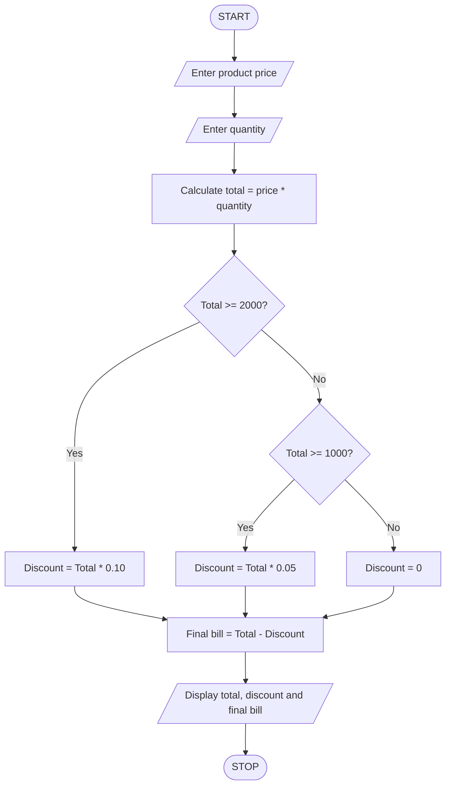

# Shopping Bill and Discount Calculator Using Python

## 1. Problem Statement

Write a Python program to calculate a shopping bill based on product price and quantity purchased by a customer.

The program should:

- Accept the product price.
- Accept the quantity purchased.
- Calculate the total amount.
- Apply a 10% discount if the total amount is Rs. 2,000 or above.
- Apply a 5% discount if the total amount is Rs. 1,000 or above but less than Rs. 2,000.
- No discount is provided if the total amount is below Rs. 1,000.
- Calculate and display the final bill after discount.

## 2. Algorithm

1. Start the program.
2. Enter the product price.
3. Enter the quantity purchased.
4. Calculate the total amount by multiplying price and quantity.
5. Check whether the total amount is greater than or equal to Rs. 2,000.
6. If yes, calculate a 10% discount.
7. Otherwise, check whether the total amount is greater than or equal to Rs. 1,000.
8. If yes, calculate a 5% discount.
9. Otherwise, set the discount to zero.
10. Calculate the final bill by subtracting the discount from the total amount.
11. Display the total amount, discount, and final bill.
12. Stop the program.

## 3. Pseudocode
START

INPUT price
INPUT quantity

total = price * quantity

IF total >= 2000 THEN
    discount = total * 0.10

ELSE IF total >= 1000 THEN
    discount = total * 0.05

ELSE
    discount = 0

END IF

final_bill = total - discount

DISPLAY total
DISPLAY discount
DISPLAY final_bill

STOP
## 4. Flowchart 

## 5. Sample Input
Enter product price: 500
Enter quantity: 5

## 6. Sample Output
Total amount: Rs. 2500.0
Discount: Rs. 250.0
Final bill: Rs. 2250.0

